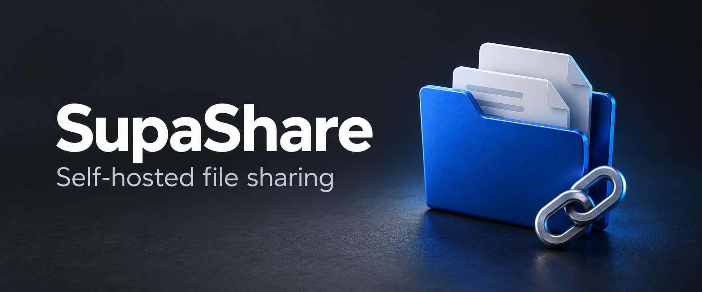
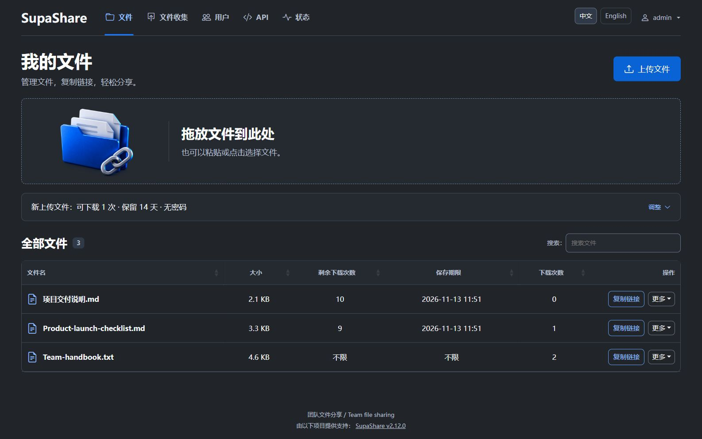
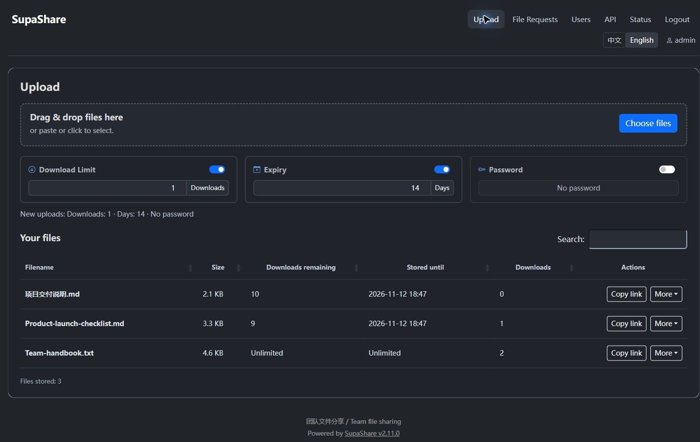
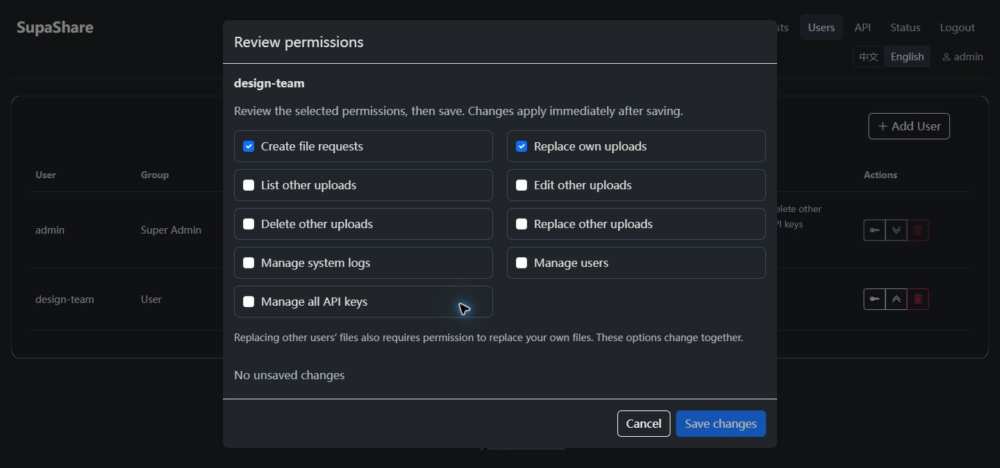

# SupaShare

[English](README.md) · **简体中文**



**分享文件，收集交付，让管理更清楚。**

SupaShare 是面向桌面浏览器和团队协作的自托管文件分享与文件收集应用。你可以为分享设置下载次数和有效期，通过文件收集链接接收交付，并在简洁的深色工作台中管理访问权限。应用内置英文与简体中文界面。

项目基于 Gokapi 发展，由 Activer007 独立维护，拥有自己的界面、功能改进和版本线。当前源码版本为 **2.14.0**。请从本仓库构建，并在 [Releases 页面](https://github.com/Activer007/SupaShare/releases)查看是否已有明确发布的 SupaShare 安装包；上游 Gokapi 镜像不包含本项目的修改。

[快速开始](#快速开始) · [界面展示](#界面展示) · [站点定制](#站点定制) · [文档导航](#文档导航)

## 为团队日常分享而设计

| 能力 | 你可以做什么 |
| --- | --- |
| 可控的文件分享 | 为文件设置下载次数、有效期及可选的访问密码。 |
| 文件收集 | 提供简化的上传链接，默认 5 天有效、每个文件默认可下载 1 次，支持 1～10 次；收到的文件可转为独立的普通分享，外部协作者无需创建账户。 |
| 中英文工作台 | 安装向导、公共页面及管理界面均可切换英文和简体中文。 |
| 站点个性化 | 在现有配置文件中设置站点名称、浏览器标题、页脚文字和帮助链接。 |
| 便捷的账户交付 | 创建本地密码登录用户后，一键复制用户名、自动生成的初始密码和登录地址；用户首次网页登录后必须修改密码。 |
| 清楚的管理操作 | 查看用户/API 密钥的权限说明，复制分享链接，通过明确的保存、取消和错误提示完成操作。 |
| 灵活的存储 | 使用本地或 S3 兼容存储，并按部署需求选择加密模式。 |
| 自动化与身份集成 | 通过 REST API、CLI 接入工作流，或对接 OpenID Connect 身份提供方。 |

普通上传需要身份认证；有效文件收集链接向持有者提供受限的上传能力。去重能力取决于存储及加密模式，端到端加密上传不使用去重。加密模式的区别详见[安装指南](docs/setup.rst)。

普通用户下载收集文件时扣次数，管理员下载保留剩余次数。下载页在文件大小旁显示上传时间。历史兼容、ZIP 下载和短时重试规则详见[文件收集说明](docs/file-collections.rst)。

独立维护后的改进还包括安装凭据、会话撤销、可信代理检查、上传授权与资源限制方面的修复，以及限定范围的中断上传恢复。[变更记录](docs/changelog.rst)汇总了已交付内容，[安全任务记录](docs/security/SECURITY-TASK-BOARD.md)则区分已验证范围与延期工作。

## 界面展示

自 **2.12.0** 引入的桌面界面采用顶部导航、紧凑上传区、可展开的上传规则和宽幅搜索列表。文件收集、管理页、公共页面及安装向导延续同一套深灰与蓝色设计。以下工作台图片为 **2.12.0** 应用的真实截图，使用合成演示数据；上方封面为品牌展示插图。

**中文工作台**



<details>
<summary>查看英文工作台和权限编辑器</summary>

**English workspace**



**可核对的权限编辑（2.11.0 截图）**



</details>

其他页面截图、验证范围及分批交付记录见 [UI 升级记录](docs/ui-upgrade-execution.md)。

## 快速开始

以下用于**全新安装**。安装 Git 和支持 Compose 的 Docker 后，在 POSIX shell（Linux、macOS 或 WSL）中运行：

```bash
git clone https://github.com/Activer007/SupaShare.git
cd SupaShare
cp .env.dist .env
docker compose up -d --build
docker compose logs --tail=80 supashare
```

仓库内的 Compose 文件会构建 `supashare:local`，将数据保存在 `./gokapi-data`，配置保存在 `./gokapi-config`，并将 `53842` 端口绑定到宿主机的回环地址。

1. 在启动日志中找到**安装凭据文件的路径**。日志只显示路径，不会输出密码。
2. 将下面的 `<printed-path>` 替换为该完整路径，读取文件：

   ```bash
   docker compose exec supashare cat '<printed-path>'
   ```

3. 使用电脑浏览器打开 [http://127.0.0.1:53842/setup](http://127.0.0.1:53842/setup)。使用用户名 `setup` 和文件中的密码登录，再完成安装向导。此安装凭据与随后创建的管理员账户不同。

如果部署在远程服务器上，先在自己的电脑建立 SSH 隧道，再访问同一个本地地址：

```bash
ssh -N -L 53842:127.0.0.1:53842 user@your-server
```

生产访问建议通过反向代理使用 HTTPS，并将公开服务地址配置为用户实际访问的地址。可信代理、本机安装及可选的非 root Compose 部署详见[安装指南](docs/setup.rst)。默认 Compose 部署不会启用单独的非 root 方案。

**已有部署？** 请按[更新与恢复指南](docs/update.rst)完成停服备份、升级和快照回滚；从 Gokapi 迁移时，还需阅读[迁移说明](docs/repository-identity.rst)。使用同一份数据启动 SupaShare 前，应先停止旧服务或容器，并保留现有数据卷、配置和加密密钥。

## 站点定制

将以下字段合并到现有 `config.json` 中（默认 Compose 部署为 `./gokapi-config/config.json`），保留其他配置，然后重启 SupaShare：

```json
{
  "PublicName": "团队文件中心",
  "UI": {
    "DefaultLanguage": "zh-CN",
    "Title": "团队文件中心",
    "FooterText": "供团队及协作者使用 / For our team and collaborators",
    "FooterLinks": [
      { "Text": "使用帮助 / Help", "URL": "https://example.com/help" }
    ]
  }
}
```

`DefaultLanguage` 支持 `en` 和 `zh-CN`，访问者可以自行切换语言。自定义名称和页脚文字按原文展示，需要双语时请直接填写双语内容。公共页脚同时显示软件版本，重新配置向导会保留这些设置。自定义 CSS、JavaScript 和站点图标的用法见[高级配置](docs/advanced.rst)。

## 部署与兼容性

- **桌面浏览器：** 常见手机和平板浏览器标识会收到 HTTP 403 和电脑访问提示。这是基于 User-Agent 的访问策略，不是设备身份认证；桌面浏览器和 API/CLI 客户端仍可使用。
- **部署范围：** 当前安全加固与恢复工作的验证范围面向可信小团队的单进程部署，多实例和高可用行为不在已验证范围内。
- **兼容旧配置：** `GOKAPI_*` 环境变量、既有数据和配置路径继续保留原名，便于现有部署升级。这些名称是兼容设计。
- **资源规划：** 为已存文件和上传暂存预留磁盘空间。内存、CPU 和存储需求取决于文件大小、并发量与加密模式，项目不承诺统一的最低资源或吞吐量指标。
- **异常恢复：** 无法确认的上传状态可能需要管理员核对。请遵循[上传恢复操作说明](docs/security/UPLOAD-RECOVERY-RUNBOOK.md)，避免直接删除文件或重置存储。

**2.13.1 的 SQLite＋本地存储基线**已通过隔离 Compose 安装与重启验证，以及原生 2.12.0 → 2.13.1 升级、备份恢复和升级前快照回滚。精确范围、源码快照及缓存镜像限制见 [M5 验收记录](docs/m5/M5-ACCEPTANCE.md)；这些结果不代表生产、云存储或高可用验收。

## 文档导航

| 文档 | 内容 |
| --- | --- |
| [安装指南](docs/setup.rst) | Docker、本机构建、安装凭据、HTTPS/代理与非 root 部署 |
| [使用指南](docs/usage.rst) | 分享、文件收集、用户交付、权限和 API 密钥 |
| [文件收集](docs/file-collections.rst) | 默认值、下载计数、短链接与历史策略 |
| [高级配置](docs/advanced.rst) | 语言、站点定制、存储、环境变量与上传资源限制 |
| [更新与恢复](docs/update.rst) | 停服备份、升级、独立恢复与快照回滚 |
| [迁移与项目标识](docs/repository-identity.rst) | SupaShare 项目标识、兼容名称和版本管理 |
| [变更记录](docs/changelog.rst) | 当前项目改动及单独标注的继承历史 |
| [问题排查](docs/troubleshooting.rst) | 运行诊断与故障处理 |
| [安全政策](SECURITY.md) | 如何私密报告安全问题 |

SupaShare 的行为以本仓库文档为准，部分详细指南目前为英文。上游 Gokapi 文档对应另一个持续维护的项目，可能与当前版本不同。HTTP 下的加密下载辅助页仍是外部依赖，详见迁移说明。

## 开发

使用 [go.mod](go.mod) 声明的 Go 工具链。在 Linux/macOS 或 WSL 的仓库根目录中运行：

```bash
make build       # 生成资源并构建 SupaShare 服务端
make build-cli   # 构建 supashare-cli
make test        # 使用模拟 S3 后端运行 Go 测试
```

运行更完整的本地验证时，还需安装 Node.js，并在 **Linux 原生文件系统**中执行（支持 WSL 的 Linux 文件系统，不使用 `/mnt/c` 或 `/mnt/e`）：

```bash
bash build/test-ui-local.sh
```

该脚本涵盖资源生成、前端行为测试、`test,noaws` 和 `test,awsmock` 两套 Go 测试、UI 相关竞态检查，以及默认/noaws 服务端构建，不连接真实 S3 账户。详见[贡献说明](CONTRIBUTING.md)和[本地验证记录](docs/ui-development.rst)。

可复现的问题和功能建议请提交到 [Issues](https://github.com/Activer007/SupaShare/issues)；安全问题请使用安全政策中的私密报告渠道。

## 项目来源与许可证

SupaShare 基于 **Marc Ole Bulling** 创建的 **Gokapi** 及其贡献者的工作发展，保留项目来源和现有 [GNU AGPL v3 许可证](LICENSE.md)。本项目的独立版本线从 `2.10.0` 开始，不代表曾发布 `2.3` 至 `2.9` 版本。

感谢原作者及所有持续改进项目的[贡献者](https://github.com/Activer007/SupaShare/graphs/contributors)。
